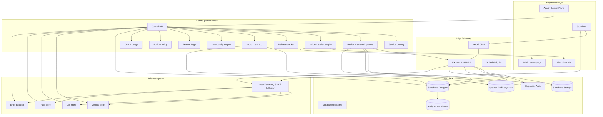

# ZEJESH Control Plane — System Architecture v0.1

**Status:** target architecture and current-state audit.  
**Scope:** the operational system behind ZEJESH: storefront runtime, API, data, content, commerce, security, and the admin console.  
**Goal:** turn the current admin panel into a real control plane: one place to observe, understand, operate, and audit the entire house.

---

## 1. Executive summary

ZEJESH today is a Vite/React storefront with an Express API and Supabase as the database, auth, storage, and realtime layer. The admin console already covers products, collections, categories, media, orders, inventory, customers, waitlists, discounts, suggestions, content, analytics, security, and a basic system-health view.

That is a good commerce back office. It is not yet a control plane.

The current “System Health” view is mostly client-side: it reads a few Supabase rows, counts events in the last minute, keeps read/write counters in `localStorage`, and verifies a round-trip write. It cannot answer the questions an operator actually asks during an incident:

- Which service is failing?
- When did it start?
- Is it the browser, the API, the database, storage, auth, or a third party?
- Which customers and orders are affected?
- What changed in the last deploy?
- Is the error budget burning?
- Who needs to be paged?
- What is the safe runbook?
- Was the action audited?

The target is a **single control plane** with real telemetry, explicit service ownership, SLOs, incident management, release tracking, job orchestration, data-quality checks, integration health, feature flags, and an append-only audit trail. It must remain deployable on the current stack and must never invent data.

---

## 2. Current-state audit

### 2.1 Runtime

| Layer | Current implementation | Strength | Gap |
| --- | --- | --- | --- |
| Storefront | Vite + React 19 + TypeScript + Tailwind | Fast, single design system, modular pages | No client telemetry beyond consent-based behavior tracking |
| API | Express in `src/serverApp.ts`, exposed via `api/index.ts` | Auth middleware, rate limiting, stable errors, service-role isolation | No request IDs, structured logs, metrics, traces, or health/readiness endpoints |
| Database | Supabase Postgres with RLS and RPCs | Security-definer checkout/vote RPCs, realtime subscriptions | No data-quality monitors, query budgets, or schema drift checks |
| Auth | Supabase Auth + `public.admins` roles | Owner/admin/editor model, JWT verification, terminal lock | No login anomaly detection, session inventory, or step-up approvals |
| Storage | Supabase Storage `media` bucket | Public read, owner-only writes, mime/size limits | No orphan/broken-asset monitor, usage/cost tracking, or checksum verification |
| Realtime | Supabase Realtime channels | Live admin updates | No channel health/latency monitoring |
| Background work | In-memory video operation cache | Simple | Lost on restart; no queue, retries, dead-letter, or job observability |
| Analytics | Consent-based event tracker + daily stats | Privacy-first, honest empty states | No warehouse, funnel warehouse, retention model, or anomaly detection |

### 2.2 Admin

Existing views:

1. Dashboard
2. System Health
3. Products & Archive
4. Collections & Drops
5. Categories
6. Media Library
7. Orders
8. Inventory Control
9. Customers
10. Waitlists
11. Discounts
12. Client Suggestions & Votes
13. Hero Slides & CMS
14. Analytics
15. AI Advisor
16. Security & Audit
17. Settings

The navigation is comprehensive for commerce operations. The missing layer is **operations of the system itself**: services, dependencies, telemetry, incidents, deployments, jobs, data quality, integrations, cost, and automation.

### 2.3 Current health view

`src/admin/health/AdminSystemHealthView.tsx` measures:

- Supabase reachability
- recent `events` rows
- events per minute
- last event timestamp
- read/write counts local to the operator’s browser
- consent state local to the operator’s browser
- a manual write/read round-trip test
- local tracker errors

This is useful as a smoke test. It is not production observability. The counts are not global, there are no historical trends, no tracing, no alerts, no service map, and no incident workflow.

### 2.4 Non-negotiables

- No fake metrics, products, orders, customers, or incidents.
- The homepage is frozen.
- Supabase remains the system of record unless a later decision replaces it.
- The admin stays dark and follows the ZEJESH design system.
- The control plane must fail closed for privileged actions.
- Every mutation must be auditable.

---

## 3. Design goals

1. **One pane of glass.** A single Command Center for system, commerce, content, security, and integrations.
2. **Real-time plus historical.** Live signal for incidents, retained rollups for trends and reviews.
3. **End-to-end causality.** Browser request → API → database → storage → response, correlated by trace/request ID.
4. **Customer-impact first.** Alerts are tied to SLOs and revenue paths, not CPU graphs alone.
5. **Operable by a small team.** On-call, runbooks, ownership, escalation, and status communication are built in.
6. **Auditable by default.** Actor, action, target, before/after, request ID, and approval are recorded.
7. **Safe automation.** Automations are explicit, reversible, and approval-gated for destructive actions.
8. **No vendor trap.** OpenTelemetry-compatible signals and a replaceable telemetry backend.
9. **Honest emptiness.** A disconnected subsystem shows “Unavailable” with the reason, never a fabricated green state.
10. **Incremental delivery.** Each phase ships a usable vertical slice, not a six-month platform rewrite.

---

## 4. Capability map

| Domain | Capability | Outcome |
| --- | --- | --- |
| Command Center | Global status, SLOs, incidents, deploys, revenue, traffic, jobs | “What is happening right now?” |
| Service Catalog | Services, owners, dependencies, runbooks, environments | “What exists and who owns it?” |
| Health | Liveness, readiness, synthetic probes, dependency checks | “Is it up and correct?” |
| Observability | Metrics, logs, traces, request correlation | “Why is it failing?” |
| SLO & Error Budgets | SLIs, targets, burn-rate alerts | “How bad is it?” |
| Incidents | Declare, assign, timeline, severity, status page | “Who is fixing it and what changed?” |
| Releases | Deploy history, version, commit, rollback, canary | “What changed?” |
| Jobs | Queues, schedules, retries, dead-letter, replay | “What is running or stuck?” |
| Data Quality | Freshness, nulls, orphans, duplicates, referential checks | “Can we trust the data?” |
| Commerce Ops | Orders, payments, refunds, inventory, conversion | “Is the business healthy?” |
| Content Ops | Hero/media/CMS freshness, broken assets, missing alt | “Is the storefront complete?” |
| Security | Auth anomalies, role changes, admin actions, secret age | “Is the house safe?” |
| Integrations | Webhooks, payment/shipping/email, delivery failures | “Is the outside world connected?” |
| Feature Flags | Gradual rollout, kill switch, environment targeting | “Can we change behaviour safely?” |
| Cost & Usage | Supabase, Vercel, storage, video generation, email | “What is this costing?” |
| AI Ops Copilot | Natural-language queries over real operational data | “Explain and summarize, with citations.” |

---

## 5. Logical architecture



### 5.1 Planes

1. **Experience plane** — storefront, admin control plane, status page, alert channels.
2. **Edge plane** — Vercel CDN, Express API/BFF, scheduled functions.
3. **Control plane** — the new system services that describe, observe, and operate the platform.
4. **Data plane** — Supabase plus Redis/queue plus optional warehouse.
5. **Telemetry plane** — OpenTelemetry-compatible metrics, logs, traces, and errors.

The control plane must not sit on the critical customer checkout path. If it is down, the storefront still sells.

---

## 6. Deployment topology

### Recommended default

| Concern | Choice | Why |
| --- | --- | --- |
| Frontend | Vercel static/CDN | Already deployed there |
| API | Vercel serverless Express | Current setup; keep until traffic demands a long-lived service |
| Database/Auth/Storage | Supabase | Already the system of record |
| Queue / rate limit | Upstash Redis or QStash | Serverless-friendly; durable jobs and distributed limits |
| Telemetry | OpenTelemetry → Grafana Cloud, Axiom, or Honeycomb | Vendor-replaceable; traces/logs/metrics in one place |
| Errors | Sentry | Browser + server error grouping and release correlation |
| Cron | Vercel Cron + QStash schedules | No always-on worker required |
| Status page | Static page backed by control-plane incident API | Public communication without exposing admin |
| Warehouse | Supabase read replica or BigQuery/ClickHouse later | Only when analytics outgrows Postgres |

### Environment model

- `development` — local, placeholder-safe, no production credentials.
- `preview` — per-PR deploy, isolated data or read-only clone, synthetic checks.
- `production` — customer traffic, strict auth, alerts, on-call.
- Optional `staging` — release candidate and destructive-test environment.

Every telemetry signal carries `environment`, `service`, `version`, and `deployment_id`.

---

## 7. Data architecture

### 7.1 Control-plane tables

Store control metadata and rollups in Postgres. Do **not** store high-cardinality logs/traces in Supabase.

| Table | Purpose |
| --- | --- |
| `system_services` | Service catalog: name, owner, tier, repo, runbook, dependencies |
| `system_environments` | dev/preview/staging/prod metadata |
| `system_health_checks` | Check definitions: HTTP, DB, storage, auth, synthetic |
| `system_health_results` | Time-series check results, latency, status, error |
| `system_slo_definitions` | SLI query, target, window, owner |
| `system_slo_windows` | Computed good/total, burn rate, error budget |
| `system_incidents` | Severity, status, commander, impact, timeline |
| `system_incident_events` | Append-only incident timeline |
| `system_alert_rules` | Condition, threshold, routing, dedupe key |
| `system_alerts` | Firing/resolved alert instances |
| `system_notification_channels` | Email, Slack, webhook, SMS |
| `system_oncall_schedules` | Rotation and escalation |
| `system_deployments` | Version, commit, environment, status, rollback target |
| `system_jobs` | Job definitions, schedule, timeout, retry policy |
| `system_job_runs` | Attempts, status, duration, error, trace ID |
| `system_data_quality_checks` | Freshness/orphan/null/duplicate definitions |
| `system_data_quality_results` | Results and failing row samples |
| `system_integrations` | Payment, shipping, email, AI, storage providers |
| `system_webhook_deliveries` | Request, response, status, retry count |
| `system_feature_flags` | Flag definitions, environments, rollout |
| `system_flag_evaluations` | Sampled evaluations for debugging |
| `system_cost_snapshots` | Provider or invoice spend by provider and service period |
| `system_cost_budgets` | Monthly spend ceilings, thresholds and owners |
| `system_runbooks` | Ordered steps, owner, verification |
| `system_runbook_executions` | Approval-gated step records for a runbook |
| `system_backup_drills` | Restore tests with measured RPO, RTO and verification |
| `system_admin_sessions` | Observed operator sessions; tokens are never stored |
| `system_security_events` | Append-only denied access and security events |
| `system_annotations` | Deploys, incidents, experiments on charts |
| `system_audit_events` | Append-only, hash-chained administrative audit |
| `system_change_requests` | Approval workflow for destructive changes |
| `system_status_incidents` | Public status-page projection |

### 7.2 Existing commerce tables

Keep the existing domain model. Add read models/views rather than duplicating tables:

- `orders`, `customers`, `products`, `inventoryLog`
- `events`, `dailyStats`
- `auditLog`
- `media_assets`
- suggestions/proposals/waves/votes
- targets/coach tables

### 7.3 Data retention

| Data | Retention |
| --- | --- |
| Health results | 90 days raw, 13 months hourly rollups |
| Metrics | 13 months rollups |
| Logs | 30–90 days in telemetry backend |
| Traces | 7–30 days, tail-sample errors |
| Incidents | Forever |
| Audit events | Forever, append-only |
| Job runs | 90 days |
| Cost snapshots | 24 months |
| Webhook deliveries | 90 days, payload redacted |

### 7.4 Audit chain

Each `system_audit_events` row stores:

```
id, occurred_at, actor_id, actor_email, role, action, target_type,
target_id, before, after, request_id, trace_id, ip_hash, user_agent_hash,
approval_id, previous_hash, hash
```

`hash = sha256(previous_hash + canonical_json(event))`.

This detects tampering and gives a defensible trail for destructive actions, role changes, refunds, price changes, and feature-flag changes.

`previous_hash` is unique (migration `0011_hardening.sql`). If two API
instances read the same tail concurrently, the database accepts one insert and
the other retries against the new tail. This turns a cross-instance fork into
optimistic concurrency control without changing the JS canonical hash format.

---

## 8. Event model

Every service emits a common envelope:

```json
{
  "id": "evt_...",
  "schema_version": 1,
  "occurred_at": "2026-11-15T12:00:00.000Z",
  "environment": "production",
  "service": "api",
  "version": "2026.11.15",
  "deployment_id": "dpl_...",
  "severity": "info",
  "type": "http.request.completed",
  "actor": { "type": "admin", "id": "..." },
  "trace_id": "...",
  "span_id": "...",
  "request_id": "...",
  "entity": { "type": "order", "id": "..." },
  "payload": {},
  "redaction": { "applied": true, "fields": ["email", "address"] }
}
```

### Core event types

- `http.request.started` / `completed` / `failed`
- `db.query.slow`
- `auth.login.succeeded` / `failed`
- `auth.role.changed`
- `order.created` / `paid` / `refunded`
- `inventory.low` / `out_of_stock`
- `media.asset.missing` / `orphaned`
- `content.hero.stale` / `asset.broken`
- `integration.webhook.failed`
- `job.started` / `succeeded` / `failed` / `dead_lettered`
- `deploy.started` / `succeeded` / `failed` / `rolled_back`
- `flag.changed`
- `incident.opened` / `acknowledged` / `resolved`
- `security.audit`
- `slo.burn_rate.high`

### Idempotency

All mutation endpoints accept `Idempotency-Key`. Events carry a deterministic `id` derived from the source operation where possible.

---

## 9. Observability model

### 9.1 Metrics

Use RED for request paths and USE for resources.

| Signal | Examples |
| --- | --- |
| Rate | Requests/min, orders/min, events/min |
| Errors | 5xx %, failed jobs, webhook failures, auth failures |
| Duration | API p50/p95/p99, DB query latency, checkout latency |
| Saturation | DB connections, storage, queue depth, memory, function duration |
| Business | Revenue, AOV, conversion, add-to-bag, refunds, low stock |
| Freshness | Event ingestion lag, dailyStats age, media probe age |

### 9.2 Logs

- Structured JSON only.
- Fields: timestamp, level, service, environment, version, request_id, trace_id, actor, route, status, duration_ms, error_code.
- Redact email, address, phone, tokens, keys, and payment data.
- No `console.log` of raw request bodies in production.

### 9.3 Traces

Instrument:

- Browser navigation and fetch
- Express middleware
- Supabase/PostgREST calls
- Storage calls
- Gemini/Veo calls
- Queue jobs
- Scheduled checks

Trace sampling: 10% baseline, 100% errors, 100% checkout/admin mutations.

### 9.4 Health checks

| Check | Type | Frequency |
| --- | --- | --- |
| API liveness | HTTP | 30s |
| API readiness (DB/auth/storage) | HTTP | 60s |
| Supabase Postgres | SQL `select 1` | 60s |
| Auth service | HTTP | 5m |
| Storage public asset | HEAD | 5m |
| Realtime channel | WebSocket | 5m |
| Checkout RPC | Synthetic transaction, staging | 15m |
| Media 404 sweep | Crawl manifest | hourly |
| Data freshness | SQL | 15m |
| DNS/TLS | External probe | 5m |

### 9.5 SLOs

| SLO | Target | Window |
| --- | --- | --- |
| Storefront availability | 99.9% | 30d |
| API availability | 99.9% | 30d |
| API latency p95 | < 300ms | 7d |
| API latency p99 | < 800ms | 7d |
| Checkout success | > 99.5% | 30d |
| Event ingestion freshness | < 30s p95 | 7d |
| Media availability | > 99.9% | 30d |
| Admin action audit coverage | 100% | 30d |

Alert on **burn rate**, not just instantaneous thresholds: 14.4x for 1h, 6x for 6h, 1x for 3d.

---

## 10. Control-plane product surface

### 10.1 Command Center

Top-level answer to “what is happening?”

- Global status: operational / degraded / incident
- Active incidents and affected services
- SLO burn and error budgets
- Requests/min, error rate, p95 latency
- Revenue today, orders, AOV, conversion
- Live visitors and active admin sessions
- Deployments in the last 24h
- Failing jobs and integrations
- Low stock and content gaps
- Security events
- One-click “declare incident”, “open runbook”, “rollback”

### 10.2 Service Map

- Services and dependencies
- Upstream/downstream
- Owner, tier, runbook
- Current health and last deploy
- Traffic, errors, latency per edge
- Click-through to traces/logs filtered by service

### 10.3 Explorer

- Unified query across metrics, logs, traces, events
- Saved views
- Time range + environment + service filters
- Shareable URLs
- Export

### 10.4 Incidents

- Severity: SEV1–SEV4
- States: investigating, identified, monitoring, resolved
- Incident commander, responders, stakeholders
- Timeline from events, deploys, alerts, and manual notes
- Customer impact and affected order count
- Status-page publish
- Post-incident review template

### 10.5 Releases

- Deploy list with version, commit, actor, environment, status
- Diff summary
- Canary/rollback controls (phase 2)
- Annotations on charts
- Release health: error rate and latency before/after

### 10.6 Jobs

- Queue depth, running, succeeded, failed, dead-letter
- Retry and replay
- Schedules
- Per-job trace and logs
- Video generation jobs are the first migration out of the in-memory cache

### 10.7 Data Quality

- Freshness: `dailyStats`, events, content
- Referential integrity: orders → products, media references
- Orphans: media assets not referenced, references to missing assets
- Nulls: required product/order fields
- Duplicates: customers, orders, events
- Schema drift: expected columns/types
- Failing rows are inspectable and exportable

### 10.8 Integrations

- Payment provider, email, shipping, storage, AI
- Credential age and last success
- Webhook delivery log with response codes
- Retry/dead-letter
- Circuit-breaker state

### 10.9 Security

- Login attempts and anomalies
- Active admin sessions
- Role and permission changes
- Destructive action approvals
- Rate-limit hits
- Secret/key age
- Audit-chain verification
- Export for compliance

### 10.10 Feature flags

- Environment/role/percentage targeting
- Kill switch
- Change history and approvals
- Evaluation tracing
- Flag cleanup reminders

### 10.11 Cost & usage

- Supabase rows, storage, egress, auth MAU
- Vercel function invocations, duration, bandwidth
- Video generation count and estimated cost
- Email/SMS usage
- Daily/monthly trend and budget alerts

### 10.12 AI Ops Copilot

Not a chatbot with guessed answers. A read-only query layer over real control-plane data:

- “What changed before the checkout error spike?”
- “Which orders are affected by the inventory mismatch?”
- “Summarize the incident timeline.”
- “Show the slowest database queries this week.”
- Every answer cites the underlying event IDs, time range, and query.

Write actions require explicit approval and are executed through the same audited control-plane API.

---

## 11. API surface

All control-plane routes require an admin JWT and RBAC. Responses include `request_id`.

```
GET  /api/control/overview
GET  /api/control/services
GET  /api/control/services/:id
GET  /api/control/health
GET  /api/control/health/:checkId/results
GET  /api/control/slo
GET  /api/control/incidents
POST /api/control/incidents
PATCH /api/control/incidents/:id
POST /api/control/incidents/:id/events
GET  /api/control/alerts
POST /api/control/alerts/:id/ack
GET  /api/control/deployments
POST /api/control/deployments
GET  /api/control/jobs
POST /api/control/jobs/:id/replay
GET  /api/control/data-quality
POST /api/control/data-quality/:id/run
GET  /api/control/integrations
GET  /api/control/webhooks
GET  /api/control/security
GET  /api/control/flags
PATCH /api/control/flags/:key
GET  /api/control/costs
POST /api/control/costs/budgets
POST /api/control/costs/snapshots
GET  /api/control/security
GET  /api/control/backups
POST /api/control/backups
PATCH /api/control/backups/:id
GET  /api/control/runbook-executions
POST /api/control/runbooks/:id/execute
POST /api/control/runbook-executions/:id/step
POST /api/control/runbook-executions/:id/abort
GET  /api/control/audit
GET  /api/control/query?metric=...&from=...&to=...
```

Public status-page projection:

```
GET /api/status
```

It exposes only sanitized incident/service state. No internal IDs, no customer data.

### Health endpoints

```
GET /health/live   -> process is alive
GET /health/ready  -> DB, auth, storage, queue, required env
GET /health/deep   -> dependency latency and version metadata (admin only)
```

---

## 12. Security and governance

### Roles

| Role | Capabilities |
| --- | --- |
| Owner | Everything; approves destructive changes |
| Admin | Operations, content, orders; cannot change owner/roles |
| Editor | Content/media/products; no orders/security |
| Analyst | Read-only analytics/control plane |
| Support | Orders/customers with PII masking |
| Read-only | View only |

### Controls

- RBAC enforced server-side, not by hiding UI.
- Step-up auth for refunds, deletions, role changes, flag kill switches.
- Two-person approval for destructive or high-value actions.
- Idempotency keys on mutations.
- Audit hash chain verified daily.
- Secret manager only; no keys in client bundles.
- PII masking in logs, traces, and support views.
- Rate-limit and abuse detection on auth and public forms.
- CSP, HSTS, frame denial, referrer policy.
- Dependency and container scanning in CI.
- Backups and restore drills with measured RTO/RPO.

---

## 13. Reliability and disaster recovery

| Concern | Target |
| --- | --- |
| Storefront availability | 99.9% monthly |
| Admin control plane availability | 99.5% (not on checkout path) |
| RPO (database) | ≤ 5 minutes |
| RTO (database) | ≤ 60 minutes |
| Backup restore drill | Quarterly |
| Incident first response | ≤ 15 minutes for SEV1 |
| Status-page update | ≤ 10 minutes after SEV1 declaration |

Runbooks must exist for:

- Supabase outage
- Auth outage
- Storage outage
- Payment provider failure
- Checkout error spike
- Inventory mismatch
- Stuck video job
- Bad deploy / rollback
- Credential leak
- Admin account compromise
- Data corruption / restore

---

## 14. Phased roadmap

### Phase 0 — Foundation (1–2 weeks)

- Add `system_*` schema and migrations.
- Add request IDs and structured server logs.
- Add `/health/live`, `/health/ready`, `/health/deep`.
- Add a control-plane API skeleton with auth and honest disconnected states.
- Replace the current System Health view with a real Command Center shell.
- Define service catalog entries and ownership.
- Instrument browser and API with OpenTelemetry-compatible trace IDs.
- Add synthetic checks for storefront, API, DB, auth, and storage.

### Phase 1 — Visibility (2–4 weeks)

- Ship the service map and health history.
- Ship metrics/logs/traces explorer with saved views.
- Add SLOs, error budgets, and burn-rate alerts.
- Add deployment tracking and release annotations.
- Add incident declaration, timeline, and status page.
- Add data-quality checks for orders, products, media, and events.
- Add integration/webhook health.

### Phase 2 — Operations (3–5 weeks)

- Add durable job orchestration; migrate video generation off the in-memory cache.
- Add runbook execution with approvals.
- Add feature flags and kill switches.
- Add cost/usage dashboards and budgets.
- Add security analytics and audit-chain verification.
- Add backup/restore drills and chaos exercises.

### Phase 3 — Intelligence (ongoing)

- Anomaly detection on revenue, conversion, errors, latency, and inventory.
- Forecasting for stock, cash, and traffic.
- AI Ops Copilot over real telemetry with citations.
- Automated remediation for low-risk, reversible faults.
- Capacity and cost optimization.
- Digital twin of the storefront and order pipeline.

---

## 15. First implementation slice

**Status: Phase 0 and the Visibility layer are implemented on disk.** The schema
is in `supabase/migrations/0008_control_plane.sql` and
`supabase/migrations/0009_visibility.sql`; probes live in
`src/controlPlane/probes.ts`; history, SLOs, alerts, incidents, deployments and
data-quality checks live in `src/controlPlane/visibility.ts`; the operator
surface is `src/admin/control/AdminControlPlaneView.tsx`; request-level health
endpoints are `/health/live`, `/health/ready` and `/health/deep`; the service
catalogue is `src/controlPlane/catalog.ts`.

The visibility layer adds persisted hourly health history, availability SLOs,
burn-rate calculations, alert reconciliation, incident command with a timeline,
a deployment register, and read-only data-quality checks. Full OpenTelemetry
trace/log storage and integration health remain Phase 1 follow-ups.

The operations layer is implemented in
`supabase/migrations/0010_operations.sql` and
`src/controlPlane/operations.ts`: durable video job runs, feature flags with a
live `video_generation` kill switch, seeded incident runbooks, owner-approved
change requests, and a hash-chained append-only audit trail with verification.

The hardening layer is implemented in `supabase/migrations/0011_hardening.sql`
and `src/controlPlane/hardening.ts`: unique-tail audit appends with retry,
provider cost snapshots and monthly budgets, admin-session and denied-access
analytics, privileged-mutation rollups, approval-gated runbook checklist
execution, and backup/restore drill records. The control plane exposes these as
the Costs, Security and Backups tabs and extends Runbooks with tracked
execution. Cost figures, sessions, drills and restores are stored only when a
real snapshot or operator observation is recorded; missing data renders as
unavailable.

The first slice was deliberately small enough to ship and real enough to matter:

1. **Schema:** `system_services`, `system_health_checks`, `system_health_results`, `system_incidents`, `system_alerts`, `system_deployments`, `system_jobs`, `system_job_runs`, `system_audit_events`.
2. **Server:** request ID middleware, structured logger, `/health/live`, `/health/ready`, `/health/deep`, `/api/control/overview`, `/api/control/health`, `/api/control/service`.
3. **Probes:** API, Supabase, auth, storage, media manifest, event freshness.
4. **Admin:** new `Control Plane` view with:
   - global status
   - service health grid
   - SLO summary
   - active incidents
   - latest deploy
   - failing jobs
   - real “last checked” timestamps
   - honest “Not configured” states
5. **Write path:** every probe result and admin action writes an audit/telemetry event.
6. **No fake data:** if Supabase is unconfigured, the view says so and shows which checks could not run.

This slice proves the architecture without pretending the whole platform exists.

---

## 16. Open decisions

These need a deliberate choice before Phase 1 hardens:

1. **Telemetry backend:** Grafana Cloud, Axiom, Honeycomb, or self-hosted Grafana/Loki/Tempo.
2. **Queue:** Upstash QStash vs Redis-backed BullMQ on a long-lived worker.
3. **Environments:** do we add staging before or after the control plane?
4. **Status page:** public subdomain or `/status` within the storefront?
5. **Alert channels:** email only, Slack, or SMS/on-call.
6. **Data warehouse:** stay in Postgres or add ClickHouse/BigQuery for long-term analytics.
7. **Approval policy:** which actions require two-person approval.
8. **Budget ceiling:** monthly observability and queue spend.

Until those are chosen, the default is:

- OpenTelemetry-compatible instrumentation
- Supabase Postgres for control metadata
- Upstash for queue/distributed lock
- Vercel Cron for schedules
- Email + Slack for alerts
- No new vendor on the critical checkout path
